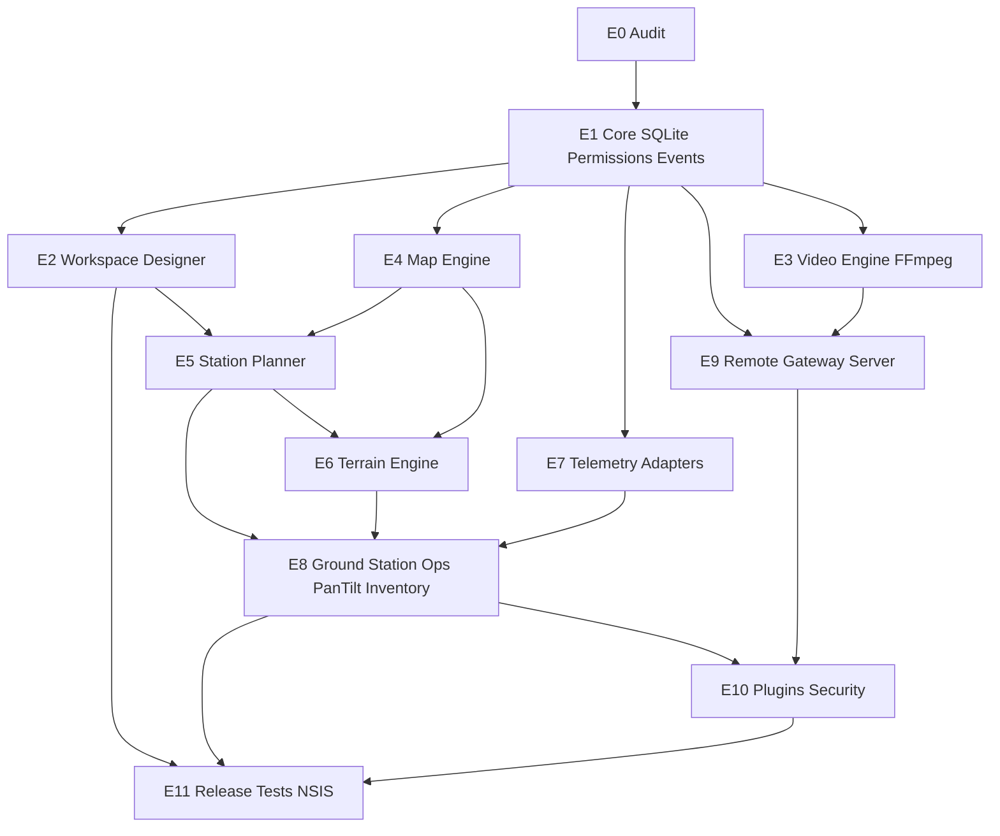

# Aether Ground Station V2.0 — Roadmap внедрения

**Связанный аудит:** [`AETHER_V2_IMPLEMENTATION_AUDIT.md`](./AETHER_V2_IMPLEMENTATION_AUDIT.md)  
**Репозиторий:** https://github.com/Order-Code67/aether-ground-station  
**Правило:** не начинать следующий этап без согласования результата предыдущего.  
**Push в GitHub:** только по отдельному разрешению пользователя.

---

## Принципы

1. Расширять существующий код 0.4.0, не создавать новый проект.
2. Сохранять работающие COM / USB / MediaDevices / error boundaries.
3. Сначала фундамент данных и прав, затем домен Station/Terrain.
4. Каждый этап: план файлов → реализация → тесты → краткий отчёт.
5. Не реализовывать удалённое управление исполнительными механизмами / пилотирование.

---

## Граф зависимостей этапов

---

## Этап 0 — Аудит

| | |
|--|--|
| Статус | **Выполнен** (2026-11-11) |
| Артефакты | `docs/AETHER_V2_IMPLEMENTATION_AUDIT.md`, этот roadmap |
| Выход | Согласование плана Этапа 1 |

---

## Этап 1 — Core (стабилизация ядра)

**Цель:** единый SSOT, безопасные права, расширяемая схема БД, диагностика.

### Состав работ

1. **Versioned SQLite migrations** (`schema_version`), индексы, FK где уместно.
2. Свести workspace/profiles/devices к SQLite; убрать dual-write localStorage или сделать односторонний cache.
3. **Permission Engine:** enforcement в UI (`can`) + проверка на критичных Tauri commands.
4. Типизированный **Event Bus** (DeviceConnected/Lost, VideoSignal*, …) поверх текущего bus.
5. DeviceStatus + **Reconnecting**; выравнивание карточек устройств.
6. Скелет **Diagnostics Manager** (сбор ошибок модулей → журнал + export JSON).
7. Vitest: auth permissions, profile import, workspace movePanel, telemetry normalize.
8. Документация схемы БД.

### Зависимости

Нет (первый implementation-этап).

### Критерий готовности

- Миграции применяются на чистой и существующей БД 0.4.
- Observer не может вызвать manage-операции.
- `npm run typecheck` + vitest critical + `cargo check` зелёные.
- Нет регрессии COM/USB/video open path.

### Не входит

Station Planner, DEM, FFmpeg service, PostgreSQL.

---

## Этап 2 — Workspace Designer

**Зависит от:** E1 (persist layouts в SSOT).

### Состав

- Довести drag-and-drop / resize до стабильного UX.
- Вкладки, pin/unpin, профили раскладок (уже частично есть).
- Панели под будущие Station/Terrain/Pan-Tilt (регистрация kind без полной логики).
- Подготовка multi-monitor (сохранение геометрией окон — по возможности Tauri).

### Критерий

Сохранение/загрузка layout через SQLite; сценарий перестановки панелей покрыт тестом store.

---

## Этап 3 — Video Engine

**Зависит от:** E1 (devices + events + recordings schema).

### Состав

- Спека и прототип **Video Capture Service** (Rust/FFmpeg) для RTSP/UVC вне WebView.
- Сохранить MediaDevices как адаптер fallback.
- Multi-channel model (N источников → N панелей).
- Состояния сигнала 1–7 из ТЗ §6.
- Walksnail остаётся через capture mode.

### Критерий

Реальный RTSP *или* документированный адаптер + hardware gate; запись + metadata в SQLite; без фиктивного видео.

### Риск

FFmpeg bundling на Windows — отдельное решение (system FFmpeg vs embed).

---

## Этап 4 — Map Engine

**Зависит от:** E1; желательно параллельно E2.

### Состав

- Слои: offline / XYZ / OSM; задел satellite/topo при наличии источника.
- Domain markers: станции/комплексы (ID из БД), не только ad-hoc pins.
- Треки телеметрии (потребитель E7).
- API для азимутальной линии (использует E5).

### Критерий

Офлайн-режим без сети; маркеры станций после E5 сохраняются.

---

## Этап 5 — Station Planner + Mast/Antenna/Orientation

**Зависит от:** E1 (схема stations/masts/antennas), E4 (карта).

### Состав

- CRUD станций на карте (drag marker, ручные координаты).
- Карточка станции (§9.2).
- Расчёт **Antenna Center AMSL** по формуле ТЗ (§9.3) — unit tests обязательны.
- Mast profiles, Antenna geometry, азимут true/magnetic раздельно.
- Отображение направления на карте.
- Сценарий A (ручной / Playwright later).

### Критерий

Создание станции → сохранение → перезапуск → координаты и высоты на месте.

### Не входит

Гарантия радиолинка по геометрии.

---

## Этап 6 — Terrain Engine

**Зависит от:** E4, E5.

### Состав

- Адаптеры DEM: GeoTIFF first; SRTM/Copernicus как источники по мере доступности.
- Height at point, terrain profile panel, missing-data states.
- Placement compare A/B/C (§15).
- Metadata: source, resolution, vertical datum, uncertainty.

### Критерий

Профиль по реальному DEM-файлу; N/A при отсутствии данных; сценарий B.

### Риск

Размер DEM / производительность — worker thread, не блокировать UI.

---

## Этап 7 — Telemetry Engine

**Зависит от:** E1; усиливается после E4 (треки).

### Состав

- Единая NormalizedTelemetry модель (расширение текущего normalize).
- Адаптеры: ESP32 (есть) · PX4 · ArduPilot · generic sensors.
- История в SQLite, графики, warnings, CSV/JSON export.
- События TelemetryUpdated / connection quality.

### Критерий

N/A для отсутствующих полей; запись истории переживает рестарт.

---

## Этап 8 — Ground Station Ops + Pan-Tilt + Inventory

**Зависит от:** E5, E6; E7 желателен.

### Состав

- Ground Station Manager UI поверх Station domain.
- Site Manager, Equipment Inventory, Maintenance.
- Power / Environment panels (N/A без датчиков).
- **Pan-Tilt Manager:** Simulation · Monitoring · Local Device Status only.
- Запрет remote actuator commands (явные API guards).
- Multi-Complex Manager (расширение profiles).

### Критерий

Сценарии C и E; simulation не пишет на железо; monitoring только отображает.

---

## Этап 9 — Remote Infrastructure

**Зависит от:** E1, E3 (video relay later), E8 (что синхронизировать).

### Состав

- Отдельный сервис Gateway/Central Server (не внутри UI-процесса обязательно).
- PostgreSQL на сервере; локальный SQLite остаётся SSOT desktop offline.
- TLS/WSS, sessions, audit, sync статусов/телеметрии/видео meta.
- Явная индикация stale data при потере связи.

### Критерий

Sandbox/integration без demo-станций-как-реальных; нет pilot channel.

---

## Этап 10 — Plugins and Security

**Зависит от:** E1, E9 (для remote roles).

### Состав

- Plugin Manager: registry, permissions, error isolation.
- Усиление credential storage, audit log UI, backup/restore verification.
- User admin UI (создание ролей) для Administrator.

### Критерий

Плагин с ошибкой не роняет shell; Observer read-only end-to-end.

---

## Этап 11 — Release

**Зависит от:** E2–E10 по мере готовности MVP V2 (минимум E1+E5+E6+E3-partial+E11 tests).

### Состав

- Vitest расширенный + Playwright сценарии A–E.
- Performance: code-split map/video.
- NSIS installer, smoke post-install, docs V2.
- Подпись / updater — по наличию сертификата (не блокирует функциональный V2).

### Критерий готовности продукта

Чеклист ТЗ §47 для согласованного MVP-среза (полная матрица §47 может закрываться итерациями).

---

## Предлагаемый MVP V2.0 (согласовать)

Чтобы не ждать полной реализации всех §18–§28, рекомендуется зафиксировать **MVP-срез**:

1. E1 Core complete  
2. E2 Workspace stable  
3. E3 UVC+record + RTSP path (хотя бы один реальный)  
4. E4 Map + station markers  
5. E5 Station Planner + AMSL math + azimuth  
6. E6 GeoTIFF DEM + terrain profile  
7. E8 Pan-Tilt Simulation/Monitoring (local)  
8. E11 tests + installer  

Остальное (Robotics, Aerial, HID, full Inventory/Maintenance, PostgreSQL remote) — **V2.1+**, если согласуете.

---

## Следующий шаг после согласования

**Только Этап 1 — Core**, без Station Planner и без массовых UI-модулей.

Ожидаемый выход Этапа 1:

- Миграции + SSOT  
- Permissions UI+Rust  
- Domain events + diagnostics skeleton  
- Vitest на критичных unit  
- Короткий отчёт «что изменено / что проверено»

---

*Конец roadmap. Ожидается явное согласование пользователя.*
